<h1 align="center">Hi 👋, I'm Ishmum Tahmid</h1><h3 align="center">Backend Developer | Java & Spring Boot | Exploring AI Engineering</h3>
 Computer Science student from Bangladesh 🇧🇩 who enjoys building backend systems, designing REST APIs, learning application security, and solving programming problems. 

 <a href="mailto:ishmamtahmid8@gmail.com">Email me</a> • <a href="https://github.com/Ishmam07">GitHub</a> • <a href="https://codeforces.com/profile/whoami0101">Codeforces</a> 

👨‍💻 About Me
🔭 Currently working on Khabar Koi, a collaborative food marketplace project for the DIU community.
🌱 Currently learning Python, FastAPI, and AI engineering fundamentals.
💻 Core focus: Java, Spring Boot, Spring Security, REST APIs, and databases.
🧠 Practising problem solving through Codeforces and algorithmic challenges.
🚀 Long-term goal: building reliable backend systems and intelligent applications.
🌌 Outside coding, I enjoy exploring space exploration missions and spacecraft.
📫 Reach me at ishmamtahmid8@gmail.com.
🤝 Connect with Me

      

🛠️ Languages & Technologies
Backend Development

  

Databases & Caching

  

Tools & Development Environment

  

Programming & Web Fundamentals

  

Currently exploring AI/ML, data analysis, and integrating AI capabilities into backend applications.

🚀 Featured Projects

   

 <strong>🍲 Khabar Koi</strong> — Collaborative food marketplace project for the DIU community.  <a href="https://github.com/morsalin101/kitchen-frontend">View repository</a> 

 <a href="https://github.com/Ishmam07?tab=repositories">Explore all my repositories →</a> 

📊 GitHub Analytics

  

  

   

📈 Contribution Activity

 <picture> <source media="(prefers-color-scheme: dark)" srcset="https://raw.githubusercontent.com/Ishmam07/Ishmam07/output/github-contribution-grid-snake-dark.svg" /> <source media="(prefers-color-scheme: light)" srcset="https://raw.githubusercontent.com/Ishmam07/Ishmam07/output/github-contribution-grid-snake.svg" />  </picture> 

🏆 GitHub Achievements

  

🧩 Competitive Programming

   

I enjoy improving my problem-solving skills through algorithms, data structures, and competitive programming.

🌌 Beyond Coding
When I'm not coding, I enjoy exploring space exploration missions, learning about spacecraft, and imagining what the next generation of space technology will look like.

 <i>Building consistently, learning deeply, and improving one commit at a time. 🚀</i> 

  

⋮⋮⋮⋮⋮⋮⋮⋮
